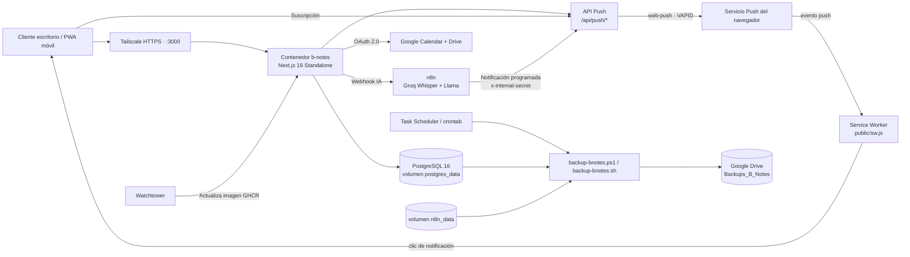
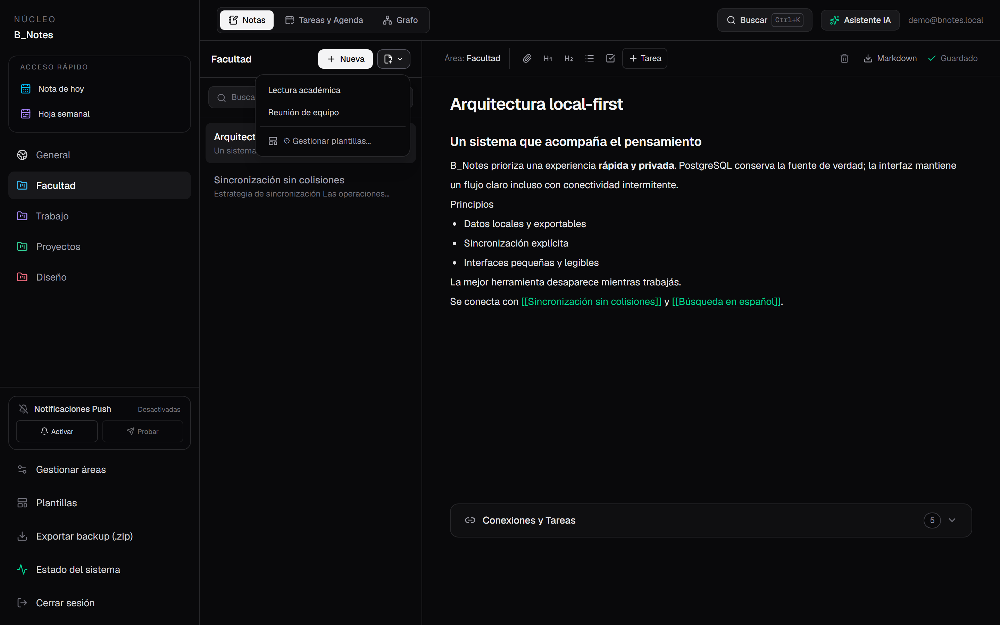
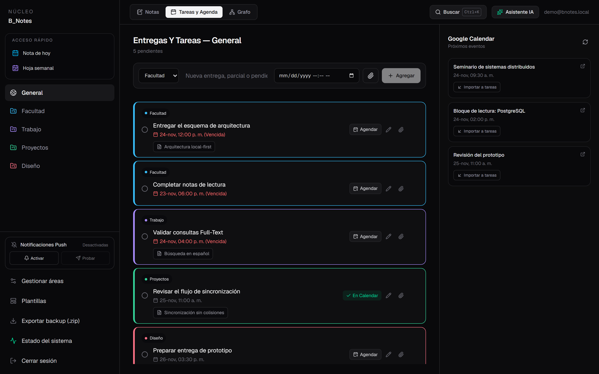
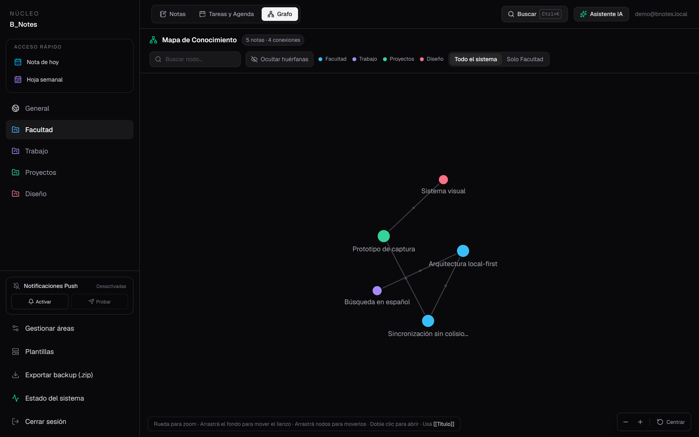
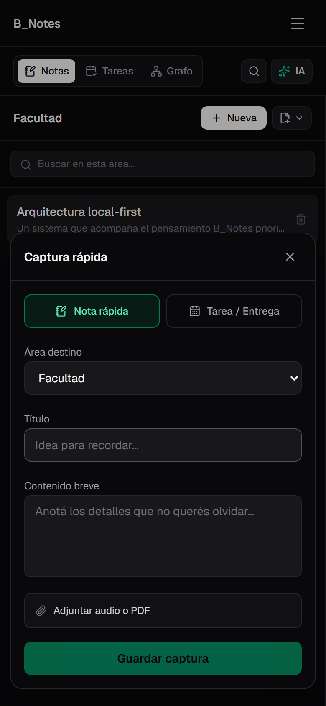

# B_Notes

[](https://nextjs.org/)
[](https://www.postgresql.org/)
[](https://docs.docker.com/compose/)
[](https://n8n.io/)
[](https://tailscale.com/)
[](https://github.com/TITA-b/b_notes/actions/workflows/docker-publish.yml)

**B_Notes** es un espacio personal *local-first* para notas, tareas y conocimiento, con asistente de IA, voz y sincronización opcional con Google Calendar y Drive. El acceso remoto puede mantenerse privado con Tailscale.

## Arquitectura del Sistema

| Servicio | Función | Puerto |
| --- | --- | --- |
| `b-notes` | Aplicación web y API (Next.js) | `3000` |
| `postgres` | PostgreSQL 16; datos persistidos en `postgres_data` | Interno |
| `n8n` | Automatizaciones y asistente de IA; datos en `n8n_data` | `5678` |
| `watchtower` | Actualiza la imagen de B_Notes desde GHCR | Interno |



## Capturas de Pantalla

Las imágenes muestran B_Notes en tema oscuro y usan exclusivamente contenido sintético de demostración.

<table>
  <tr>
    <td align="center"><strong>Editor de notas · Escritorio</strong><br></td>
    <td align="center"><strong>Tareas y Agenda · Escritorio</strong><br></td>
  </tr>
  <tr>
    <td align="center"><strong>Grafo de conocimiento · Escritorio</strong><br></td>
    <td align="center"><strong>Captura rápida · PWA móvil</strong><br></td>
  </tr>
</table>

## Inicio rápido

Requisitos: Git y Docker Compose v2 (Docker Desktop en Windows/macOS o Docker Engine en Linux).

1. Cloná el proyecto:

   ```sh
   git clone https://github.com/TITA-b/b_notes.git
   cd b_notes
   ```

2. Creá el archivo de configuración:

   ```sh
   cp .env.example .env
   ```

   En PowerShell, usá `Copy-Item .env.example .env`.

3. Editá `.env`: reemplazá `POSTGRES_PASSWORD` y `AUTH_SECRET` por valores aleatorios seguros. Las credenciales de Google son opcionales.
4. Iniciá los servicios:

   ```sh
   docker compose up -d
   ```

Abrí `http://localhost:3000` y creá tu cuenta local. Para publicar la aplicación en una Mini PC, conectar servicios externos o instalarla en el móvil, consultá la [guía de despliegue](docs/DEPLOYMENT.md). Para programar respaldos y migrar datos, seguí la [guía de backups](docs/BACKUPS.md).

## Funcionalidades principales

- **Puente Notas ↔ Tareas y backlinks:** creá tareas vinculadas desde el editor o convertí una selección de texto. El panel *Conexiones y Tareas* reúne tareas relacionadas, menciones inversas `[[wikilinks]]` y enlaces para navegar entre notas y tareas.
- **Daily & Weekly Notes:** abrí o creá la *Nota de hoy* con `Alt + D` y la *Hoja semanal* con `Alt + W`. La nota semanal se puede resetear; ambas sincronizan tareas pendientes y eventos de Google Calendar.
- **Asistente IA con búsqueda Full-Text:** PostgreSQL rankea notas y tareas en español para ofrecer contexto relevante. Las citas de notas en el chat son clickeables y las fuentes consultadas se pueden desplegar.
- **Web Push y adjuntos con IA:** notificaciones nativas VAPID desde B_Notes o workflows programados de n8n. Transcribí audios con Groq Whisper y resumí o extraé texto de PDFs desde el editor o la captura rápida.

## Atajos de teclado

| Atajo | Acción |
| --- | --- |
| `Alt + D` | Abrir o crear la Nota de hoy |
| `Alt + W` | Abrir o crear la Hoja semanal |

## Variables de entorno

| Variable | Uso | Valor inicial / requisito |
| --- | --- | --- |
| `POSTGRES_USER` | Usuario de PostgreSQL | `bnotes` |
| `POSTGRES_PASSWORD` | Contraseña de PostgreSQL y conexión interna de la app | Obligatoria; reemplazar en `.env` |
| `POSTGRES_DB` | Base de datos de PostgreSQL | `bnotes` |
| `AUTH_SECRET` | Firma de sesiones | Obligatoria; secreto aleatorio de al menos 32 caracteres |
| `N8N_WEBHOOK_URL` | Webhook del asistente | Opcional; `http://n8n:5678/webhook/b-notes-assistant` |
| `GOOGLE_CLIENT_ID` | Cliente OAuth de Google | Opcional |
| `GOOGLE_CLIENT_SECRET` | Secreto OAuth de Google | Opcional |
| `GOOGLE_REDIRECT_URI` | URI de retorno OAuth | `http://localhost:3000/api/google/callback`; cambiar al usar un dominio HTTPS |
| `NEXT_PUBLIC_VAPID_PUBLIC_KEY` | Clave pública VAPID para suscripciones Push | Opcional; generar con `npx web-push generate-vapid-keys` |
| `VAPID_PRIVATE_KEY` | Clave privada para firmar notificaciones | Opcional; mantener secreta y fuera de Git |
| `VAPID_SUBJECT` | Contacto VAPID (`mailto:` o URL HTTPS) | `mailto:admin@bnotes.local` |
| `INTERNAL_PUSH_SECRET` | Autenticación de notificaciones disparadas desde n8n | Opcional; secreto aleatorio, enviar en `x-internal-secret` |
| `BNOTES_BACKUP_DIR` | Carpeta destino de `backup-bnotes.ps1` / `backup-bnotes.sh` | Opcional; se detecta Google Drive en el script de Windows/macOS; si no, `./backups` |
| `DATABASE_URL` | Conexión para desarrollo local | Compose la construye a partir de `POSTGRES_PASSWORD`; `.env.example` la muestra como referencia |

Generá el par VAPID una sola vez desde la raíz del proyecto con `npx web-push generate-vapid-keys`. Copiá la clave pública y privada a `.env`; nunca publiques la clave privada. Los pasos de configuración y activación en Android están en la [guía de despliegue](docs/DEPLOYMENT.md).

## Documentación

- [Despliegue por sistema operativo, IA, Google y acceso móvil](docs/DEPLOYMENT.md)
- [Backups automáticos y restauración/migración](docs/BACKUPS.md)
